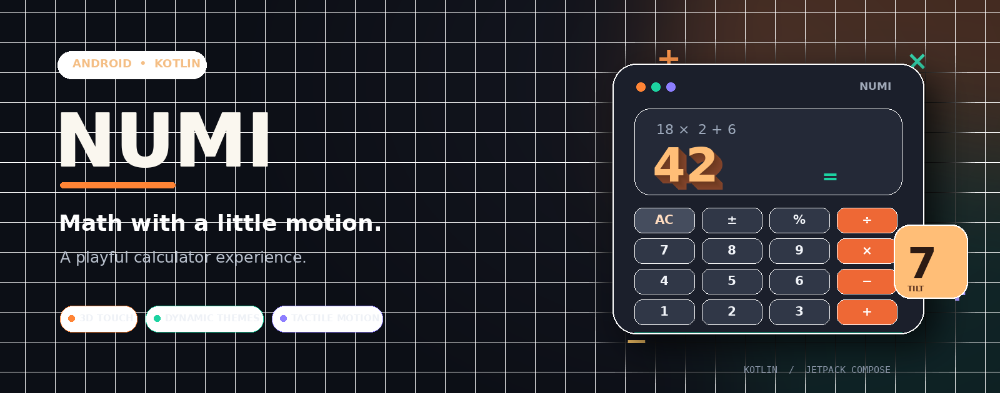

# NUMI ✨
### Math with a little motion.

**NUMI** is a playful, interactive Android calculator designed to make everyday mathematics feel different. Combining expressive typography, interactive 3D number animations, tactile button interactions, and customizable themes, NUMI transforms a traditional calculator into a delightful visual experience.

<div align="center">
  
</div>
---

## 🌟 About NUMI

Most calculator applications focus only on functionality. NUMI explores a different approach: making the experience of calculating just as enjoyable as the result.

Inspired by playful interaction and expressive motion design, NUMI brings numbers to life through touch-responsive animations, dimensional visual effects, and carefully designed themes.

## ✨ Features

### 🧮 Interactive Calculator
- Perform everyday mathematical calculations.
- Clean and expressive calculator interface.
- Animated number display.
- Custom-designed mathematical buttons.

### 🎨 Dynamic Themes
- Multiple visual themes.
- Custom color palettes.
- Consistent styling across application screens.
- Personalized calculator appearance.

### 🌀 3D Motion & Interactions
- Interactive 3D number display.
- Touch-responsive rotation.
- Smooth spring-based animations.
- Tactile button interactions.
- Haptic feedback.

### 📜 Calculation History
- View previous calculations.
- Reuse previous results.
- Manage calculation history.

### ⚙️ Customization
- Theme preferences.
- Animation settings.
- Sound and haptic preferences.

---

## 🛠️ Tech Stack

| Technology | Purpose |
|---|---|
| Kotlin | Primary programming language |
| Jetpack Compose | Modern Android UI |
| Material 3 | UI foundation |
| MVVM | Application architecture |
| Kotlin Coroutines | Asynchronous operations |
| StateFlow | Reactive state management |
| Room Database | Local calculation history |
| DataStore | Persistent user preferences |
| Compose Animation | Interactive animations |
| GraphicsLayer | 3D visual transformations |

---

## 📂 Project Structure

```text
NUMI/
│
├── app/
│   └── src/main/
│       ├── java/com/example/
│       │   ├── animations/
│       │   ├── data/
│       │   │   ├── history/
│       │   │   └── preferences/
│       │   ├── domain/
│       │   │   ├── calculator/
│       │   │   └── models/
│       │   ├── navigation/
│       │   ├── presentation/
│       │   │   ├── calculator/
│       │   │   ├── components/
│       │   │   ├── history/
│       │   │   ├── settings/
│       │   │   └── themes/
│       │   └── ui/
│       │       ├── colors/
│       │       ├── theme/
│       │       └── typography/
│       │
│       └── res/
│
├── gradle/
├── build.gradle.kts
├── settings.gradle.kts
├── gradle.properties
└── README.md
```

---

## 🚀 Getting Started

### Prerequisites

- Android Studio (latest stable version recommended).
- JDK compatible with the project's Gradle configuration.
- Android SDK.
- Git.

### Installation

**1. Clone the repository**

```bash
git clone https://github.com/Kashif-Mashi/Numi.git
```

**2. Open the project**

Open Android Studio and select:

`File → Open → Numi`

**3. Sync Gradle**

Allow Android Studio to download the required dependencies and synchronize the project.

**4. Run the application**

- Connect an Android device with USB debugging enabled, or start an Android emulator.
- Select the `app` run configuration.
- Click Run.

Alternatively, build the debug APK from the project root:

```bash
./gradlew assembleDebug
```

On Windows PowerShell:

```powershell
.\gradlew.bat assembleDebug
```

The generated APK will be located at:

```text
app/build/outputs/apk/debug/app-debug.apk
```

---

## 🎯 Project Philosophy

NUMI follows a simple idea:

> A calculator doesn't have to be boring.

We believe even the smallest everyday interactions can be designed with creativity, personality, and attention to detail.

---

## 👨‍💻 Author

**Kashif Mashi**

- GitHub: [@Kashif-Mashi](https://github.com/Kashif-Mashi)
- Project: [NUMI](https://github.com/Kashif-Mashi/Numi)

---

## 📄 License

This project is intended to be open source. Licensing terms will be specified in the repository's LICENSE file.

---

<p align="center">
  Made with ❤️ and Kotlin.
  <br/>
  <strong>NUMI — Math with a little motion.</strong>
</p>